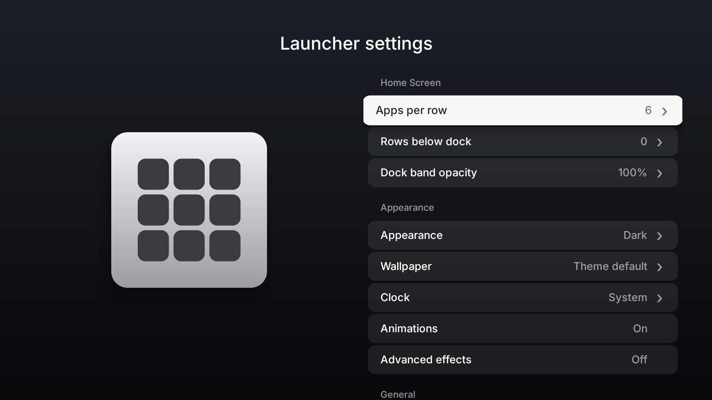

# tvOS for Google TV

A native Google TV and Android TV launcher that recreates the feel of Apple TV’s Home Screen. A floating Liquid Glass dock keeps your apps in reach, Top Shelf brings movie and series artwork into Home, and Control Center keeps everyday TV controls one panel away.


[Install on your TV](#install-on-your-tv) · [Set up with a coding agent](PROMPT.md) · [Configuration reference](themes/tvos27/README.md) · [Releases](https://github.com/bhaveshchow20/tvos-google/releases)

## Home and Top Shelf

Move across the dock with the D-pad. The focused card rises, grows slightly, and gains a thin highlight. The background follows the app’s colors. With an optional TMDB key, resting on a supported streaming app for about three seconds brings up full-screen artwork and title logos for popular movies and shows from that service in your region. Press Up while artwork is visible to expand it, or move focus to return to Home.

Hold Select to edit Home, rearrange apps, create folders, or hide a tile from Home. Open the full-screen App Library to find installed apps. Launcher settings let you adjust the dock and choose Dark, Light, or Automatic appearance, and you can turn off navigation sounds or reduce motion.

## Control Center

Select the clock and profile capsule to open Control Center over Home. From there you can open Settings, switch HDMI inputs, see Wi-Fi status, reach display controls, or set a sleep timer. With notification access, Now Playing shows the active media session with artwork and playback controls. Sleep and some remote shortcuts depend on the optional accessibility helper and your TV’s firmware.


## Wallpaper and screensaver

Scan a QR code in Launcher settings to send photos from a phone on the same Wi-Fi. The photos can rotate as wallpaper. The Aerial-style screensaver slowly pans through cached Top Shelf artwork or your wallpapers, with the time and date overlaid.

<details>
<summary>More screenshots from a physical TV</summary>

**Top Shelf with Hulu selected**


**Edit Home Screen**


**HDMI inputs**


**Launcher settings**



</details>

## Compatibility and permissions

The launcher requires Android TV or Google TV based on Android 8.0 or later. Home selection, HDMI labels and remote shortcuts depend on the device. The [installation guide](#install-on-your-tv) starts by previewing the launcher with the stock Home app still enabled.

Top Shelf contacts TMDB for provider, title and image data when you supply a key. Phone wallpaper uploads run on your local network while the upload screen is open. Notification access is optional for Now Playing, and accessibility access is optional for supported remote shortcuts and Sleep.

## Install on your TV

You need a Google TV or Android TV device running Android 8.0 or later, a computer on the same network, Git, Python 3, and Android platform tools with `adb` on your PATH. The commands below use Bash on macOS or Linux. On Windows you can use Git Bash with your Windows installation of ADB and a Python virtual environment.

### 1. Get the launcher

Clone the project so you have the TV setup tools and theme files.

```bash
git clone https://github.com/bhaveshchow20/tvos-google.git
cd tvos-google
python3 -m venv tools/venv
tools/venv/bin/python -m pip install -r tools/requirements.txt
```

In Git Bash on Windows, use `tools/venv/Scripts/python.exe` in place of `tools/venv/bin/python`.

Download an APK from [Releases](https://github.com/bhaveshchow20/tvos-google/releases), or build one with JDK 17 and Android SDK platform 34 and build tools 34. Point `ANDROID_HOME` at your SDK for the build.

```bash
(cd launcher && ./gradlew assembleRelease)
```

The build writes `launcher/app/build/outputs/apk/release/app-release.apk`. It uses Android debug signing. Builds from two computers can use different signing keys.

### 2. Connect to the TV and record its current Home app

Enable Developer options in the TV’s system settings. Open **Wireless debugging** if available. Enter the addresses and ports shown by your TV in the variables below. The pairing screen and the main debugging screen show different ports.

```bash
TV_PAIR='your-tv-ip:pairing-port'
export TV_HOST='your-tv-ip:connection-port'
adb pair "$TV_PAIR"
adb connect "$TV_HOST"
```

On TVs with **Network debugging**, use the endpoint shown by the TV for `TV_HOST` and run `adb connect "$TV_HOST"`. Accept the computer’s authorization prompt on the TV. Use the debugging connection on a trusted local network.

```bash
export TV_ADB_BINARY=adb
adb -s "$TV_HOST" get-state
adb -s "$TV_HOST" shell getprop ro.product.model
adb -s "$TV_HOST" shell getprop ro.build.version.release
adb -s "$TV_HOST" shell cmd package resolve-activity --brief --user 0 \
  -a android.intent.action.MAIN -c android.intent.category.HOME
```

Check that the state is `device` and the model matches your TV. Save the last line of the Home command, which normally looks like `package.name/.ActivityName`. If Android shows a chooser or you cannot identify a working Home app, keep this install in preview mode until you know how to restore Home.

### 3. Install, apply the theme, and preview

If you already use `com.gathin.tvhome`, save your existing theme and wallpapers before proceeding. Keep the original theme folder you applied, or try copying the TV’s current files into a private local directory:

```bash
adb -s "$TV_HOST" pull /sdcard/Android/data/com.gathin.tvhome/files ./previous-theme
```

Some TVs block access to that directory. If you need to keep the current theme and cannot retrieve it or find the original files, pause before applying the new theme. A saved configuration may contain your TMDB key.

```bash
APK='launcher/app/build/outputs/apk/release/app-release.apk'
adb -s "$TV_HOST" install -r "$APK" &&
  tools/theme.sh themes/tvos27 &&
  adb -s "$TV_HOST" shell am start -W -n com.gathin.tvhome/.MainActivity
```

Set `APK` to your downloaded file if you used Releases. The default package ID is `com.gathin.tvhome`, shared with the original CleanYourTV launcher. If Android reports an incompatible update or signature mismatch, stop. The installed copy stays in place, and removing it would erase its app data.

Applying a theme replaces the current theme files, including theme wallpapers, and resets layout and motion overrides that follow the theme.

Check the dock, D-pad navigation, and Control Center. The clock capsule opens Control Center. A plain background on an app without TMDB artwork is expected.

### 4. Make it Home when you’re ready

If your TV offers a default Home app picker, select the new launcher there. It may appear as **Home**. Otherwise, after confirming the preview works and recording the previous Home component, try:

```bash
adb -s "$TV_HOST" shell cmd package set-home-activity --user 0 com.gathin.tvhome/.MainActivity
adb -s "$TV_HOST" shell cmd package resolve-activity --brief --user 0 \
  -a android.intent.action.MAIN -c android.intent.category.HOME
```

Press Home on the physical remote to verify. Some firmware keeps its own Home app even after a successful preview. You can keep using the launcher in preview mode on those TVs.

### Optional features

- **TMDB Top Shelf**. Copy `themes/tvos27` to a local folder outside the repository. Add `"tmdb_key": "YOUR_KEY"` to the copy’s `config.json`. Leave `tmdb_region` unset for automatic region detection, or set it to a two-letter country code such as `"US"`. Apply the copy with `tools/theme.sh /path/to/your/local-theme`. Keep the key out of Git and chat transcripts.
- **Now Playing**. Enable the launcher’s notification access in the TV’s special app access settings. On devices that support it, the equivalent ADB command is `adb -s "$TV_HOST" shell cmd notification allow_listener com.gathin.tvhome/.NowPlayingListener`.
- **Sleep and remote shortcuts**. Enable the launcher’s Home button accessibility service in TV Settings if you want it. Sleep through this service needs Android 9 or later. Test shortcuts on your physical remote because firmware handles them differently.
- **Wallpaper from a phone**. In Launcher settings, open **Wallpaper → Choose from phone** and scan the QR code from a phone on the same Wi-Fi.

[All configuration options](themes/tvos27/README.md)

### Restore your previous Home

Select your previous Home app in the TV’s Home app picker, or use the component you recorded before installation.

```bash
PREVIOUS_HOME='package.name/.ActivityName'
adb -s "$TV_HOST" shell cmd package set-home-activity --user 0 "$PREVIOUS_HOME"
```

Verify with the remote’s Home button. To clear this launcher’s theme while keeping the app, run `tools/theme.sh --reset` or reapply your saved theme. When you finish, disconnect ADB and turn off the debugging modes you enabled on the TV.

For help, include your TV model, Android version, the step that failed, and the exact error with private details removed. [Open an issue](https://github.com/bhaveshchow20/tvos-google/issues)

## Credits

This independent project builds on the Android launcher and setup tools from [Gathin23’s CleanYourTV](https://github.com/Gathin23/cleanyourtv). The upstream Git history and [MIT license](LICENSE) are included. Apple TV and tvOS are design references for the interface. This project is unaffiliated with Apple. It uses TMDB data and is unaffiliated with TMDB.
