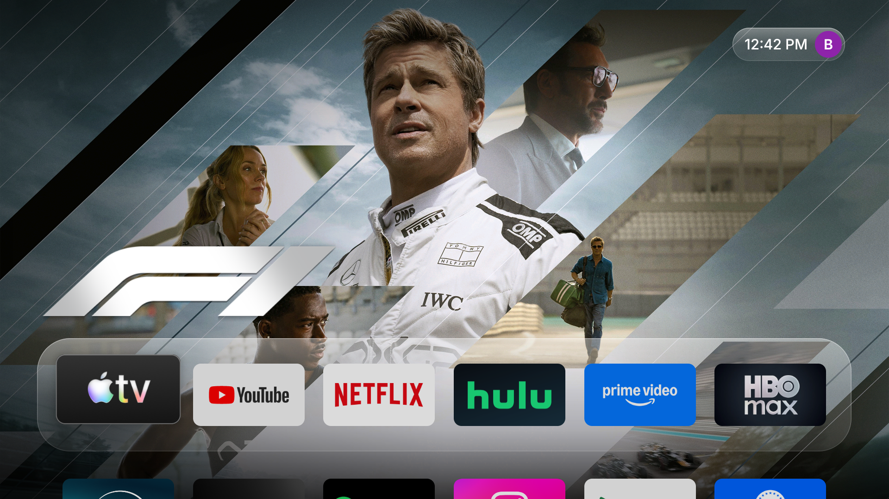
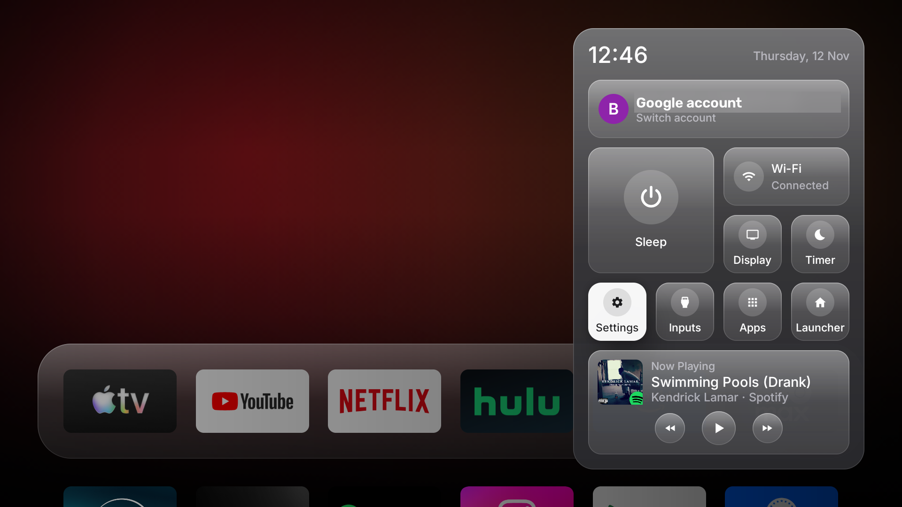
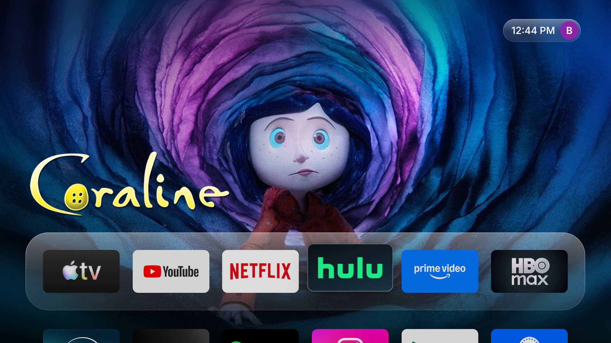
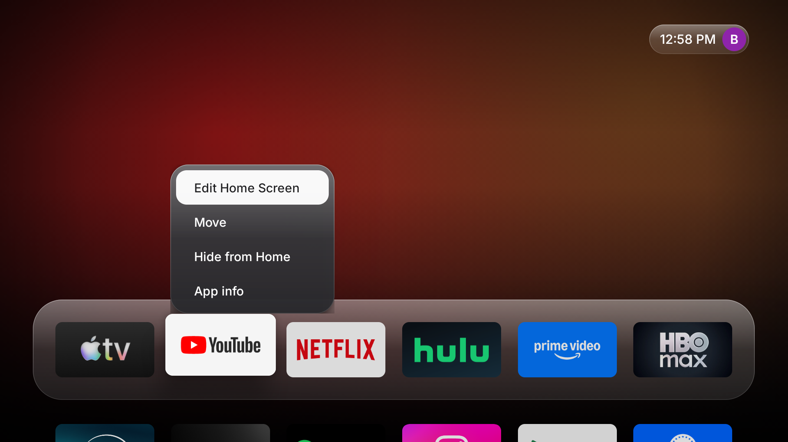
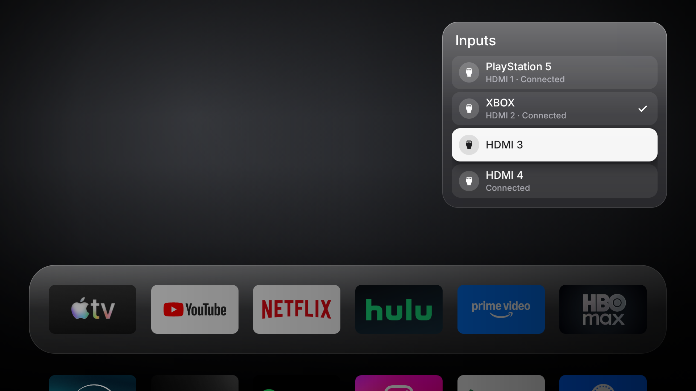

# tvOS for Google TV

A native Google TV and Android TV launcher that recreates the feel of Apple TV’s Home Screen. A floating Liquid Glass dock keeps your apps in reach, Top Shelf brings movie and series artwork into Home, and Control Center keeps everyday TV controls one panel away.

[Install on your TV](docs/INSTALL.md) · [Set up with a coding agent](PROMPT.md) · [Configuration reference](themes/tvos27/README.md) · [Releases](https://github.com/bhaveshchow20/tvos-google/releases)

## Home and Top Shelf

Move across the dock with the D-pad. The focused card rises, grows slightly, and gains a thin highlight. The background follows the app’s colors. With an optional TMDB key, resting on a supported streaming app for about three seconds brings up full-screen artwork and title logos for popular movies and shows from that service in your region. Press Up while artwork is visible to expand it, or move focus to return to Home.

Hold Select to edit Home, rearrange apps, create folders, or hide a tile from Home. Open the full-screen App Library to find installed apps. Launcher settings let you adjust the dock and choose Dark, Light, or Automatic appearance, and you can turn off navigation sounds or reduce motion.

## Control Center

Select the clock and profile capsule to open Control Center over Home. From there you can open Settings, switch HDMI inputs, see Wi-Fi status, reach display controls, or set a sleep timer. With notification access, Now Playing shows the active media session with artwork and playback controls. Sleep and some remote shortcuts depend on the optional accessibility helper and your TV’s firmware.

## Wallpaper and screensaver

Scan a QR code in Launcher settings to send photos from a phone on the same Wi-Fi. The photos can rotate as wallpaper. The Aerial-style screensaver slowly pans through cached Top Shelf artwork or your wallpapers, with the time and date overlaid.

More screenshots from a physical TV

**Top Shelf with Hulu selected**

**Edit Home Screen**

**HDMI inputs**

**Launcher settings**

## Compatibility and permissions

The launcher requires Android TV or Google TV based on Android 8.0 or later. Home selection, HDMI labels and remote shortcuts depend on the device. The [installation guide](docs/INSTALL.md) starts by previewing the launcher with the stock Home app still enabled.

Top Shelf contacts TMDB for provider, title and image data when you supply a key. Phone wallpaper uploads run on your local network while the upload screen is open. Notification access is optional for Now Playing, and accessibility access is optional for supported remote shortcuts and Sleep.

## Credits

This independent project builds on the Android launcher and setup tools from [Gathin23’s CleanYourTV](https://github.com/Gathin23/cleanyourtv). The upstream Git history and [MIT license](LICENSE) are included. Apple TV and tvOS are design references for the interface. This project is unaffiliated with Apple. It uses TMDB data and is unaffiliated with TMDB.
